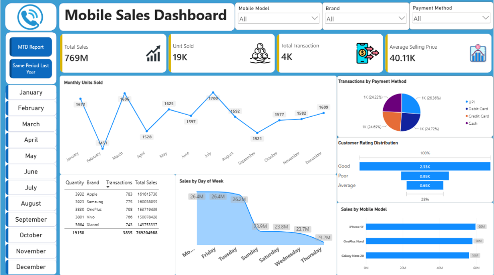
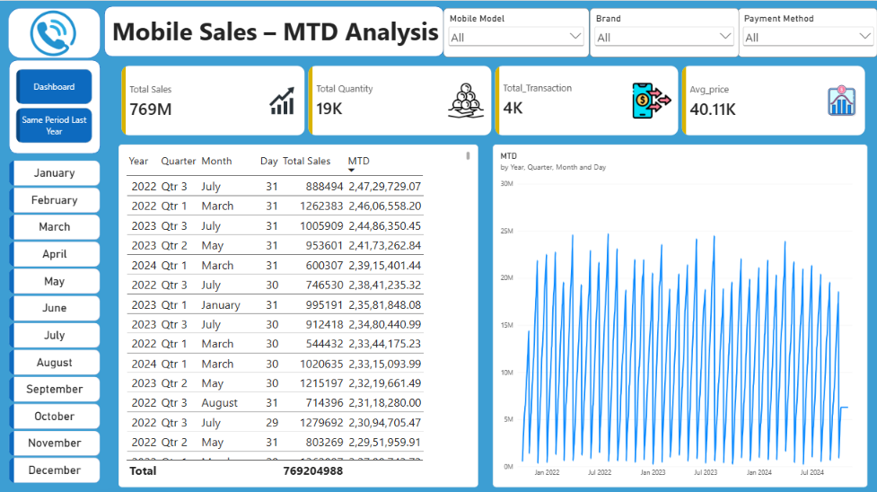
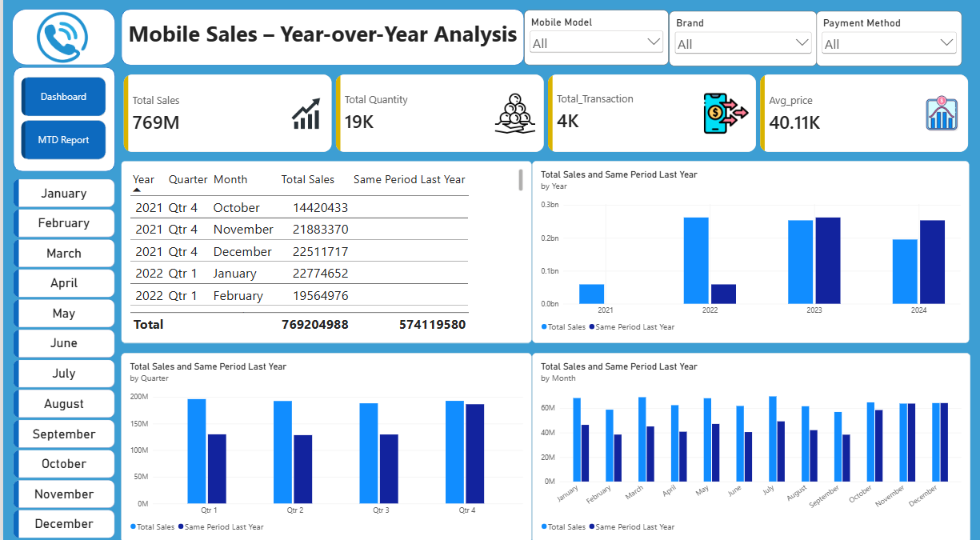

# Mobile Sales Power BI Dashboard

## Project Overview

This project presents an interactive Power BI dashboard designed to analyze mobile sales performance, customer ratings, purchasing patterns, and historical sales trends.

The dashboard consists of three report pages covering overall sales performance, month-to-date (MTD) analysis, and year-over-year (YoY) sales comparison.

## Business Objectives

- Monitor overall mobile sales performance using key performance indicators.
- Analyze sales across mobile brands, models, and cities.
- Identify monthly and daily sales trends.
- Understand customer payment preferences and rating patterns.
- Track month-to-date sales performance.
- Compare current sales with the corresponding period of the previous year.

## Dataset Description

The project uses an Excel dataset containing 3,835 data records and 14 columns.

| Column | Description |
|---|---|
| Transaction ID | Transaction identifier |
| Day | Day of transaction |
| Month | Month of transaction |
| Year | Year of transaction |
| Day Name | Day of the week |
| Brand | Mobile brand |
| Units Sold | Number of units sold |
| Price Per Unit | Selling price per unit |
| Customer Name | Customer name |
| Customer Age | Customer age |
| City | Transaction city |
| Payment Method | Payment method used |
| Customer Ratings | Customer rating |
| Mobile Model | Mobile model purchased |

## Tools & Technologies

| Tool | Purpose |
|---|---|
| Microsoft Excel | Source dataset |
| Power BI Desktop | Data modeling and dashboard development |
| DAX | Calculated measures, KPIs, and time intelligence |
| GitHub | Project documentation and sharing |

## Project Workflow

1. Imported the Excel dataset into Power BI.
2. Prepared the data for analysis.
3. Created a custom calendar table for time-based analysis.
4. Established data model relationships.
5. Developed DAX measures for sales and performance tracking.
6. Designed three interactive dashboard pages.
7. Implemented slicers and page navigation buttons.

## Dashboard Preview

### Page 1 — Mobile Sales Overview

This page provides an overview of mobile sales performance and customer purchasing patterns.

**Key Performance Indicators:**

- Total Sales
- Total Units Sold
- Total Transactions
- Average Selling Price

**Key Analysis:**

- Geographical sales distribution
- Monthly units sold
- Transactions by payment method
- Customer rating distribution
- Sales by day of week
- Sales by mobile model

### Page 2 — Month-to-Date Analysis

This page focuses on monitoring cumulative sales performance within a month using DAX time intelligence calculations.

**Key Features:**

- Month-to-date sales tracking
- Daily sales performance
- Date-based analysis
- Interactive filtering

### Page 3 — Year-over-Year Analysis

This page compares current sales with sales from the corresponding period of the previous year.

**Key Features:**

- Yearly sales comparison
- Quarterly sales comparison
- Monthly sales comparison
- Current and prior-year sales analysis

## DAX & Time Intelligence

The project demonstrates the practical application of DAX for:

- Total sales calculations
- Total quantity calculations
- Transaction counting
- Average price calculations
- Month-to-date sales
- Same-period-last-year sales

A custom calendar table supports date-based filtering and historical sales comparisons.

## Interactive Dashboard Features

- Brand filtering
- Mobile model filtering
- Payment method filtering
- Month-based filtering
- Interactive charts and KPI cards
- Navigation between report pages
- Consistent dashboard design

## Business Applications

The dashboard can help businesses:

- Identify high-performing mobile brands and models.
- Monitor sales trends and seasonal demand.
- Understand customer payment preferences.
- Evaluate customer satisfaction through ratings.
- Track monthly sales performance.
- Compare historical sales performance to support business planning.

## Repository Structure

| Folder / File | Description |
|---|---|
| Dataset/ | Original Excel dataset |
| PowerBI/ | Interactive Power BI dashboard |
| Screenshots/ | Dashboard preview images |
| README.md | Project documentation |

## How to Use

1. Download the Power BI (.pbix) file from the PowerBI folder.
2. Open the file using Microsoft Power BI Desktop.
3. Navigate between the three report pages.
4. Use the available slicers to explore sales performance.
5. To refresh the data, update the Excel source file path if required.

## Conclusion

This project demonstrates the use of Power BI and DAX to transform transactional sales data into interactive business reports. It combines sales analysis, KPI reporting, time intelligence, and dashboard design to support data-driven business decisions.

## Skills Demonstrated

Power BI · DAX · Data Modeling · Time Intelligence · KPI Reporting · Sales Analysis · Data Visualization · Dashboard Design · Business Intelligence
